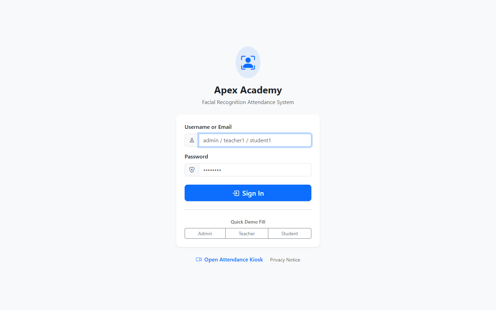
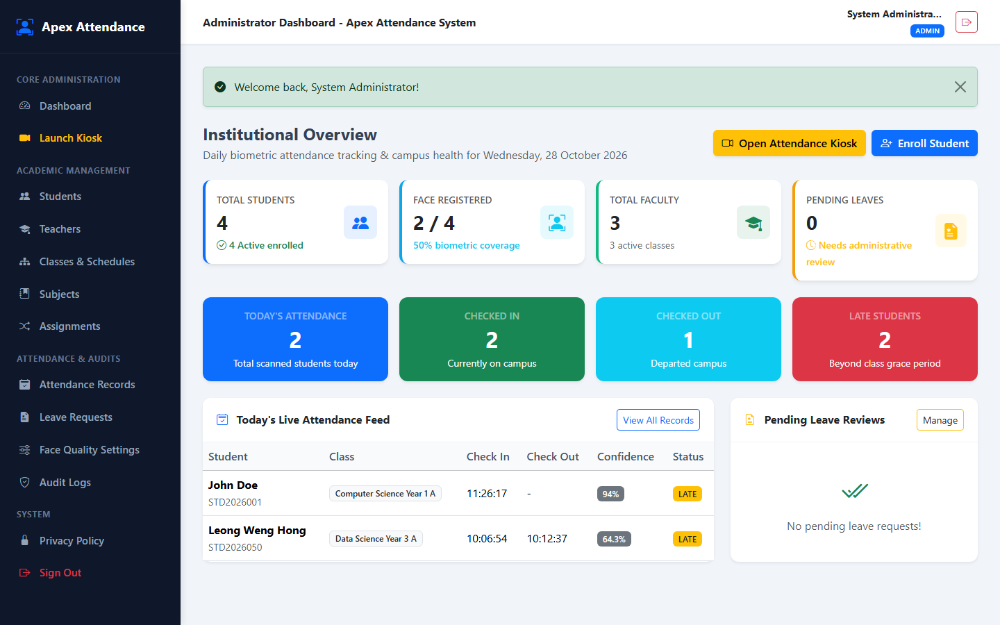
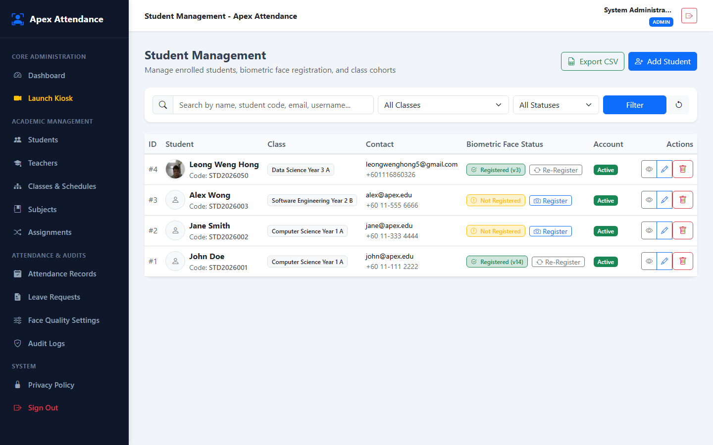
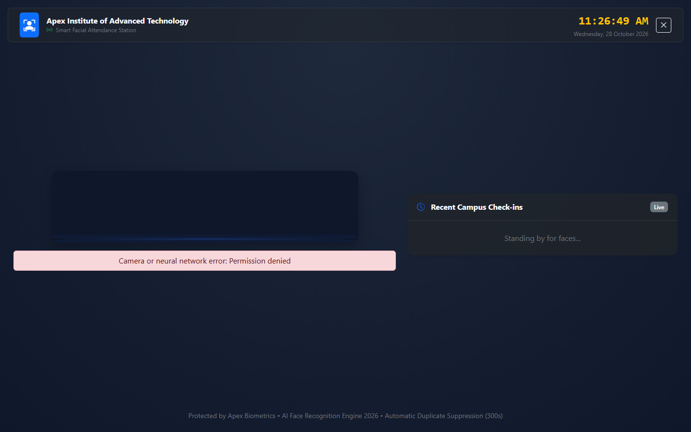
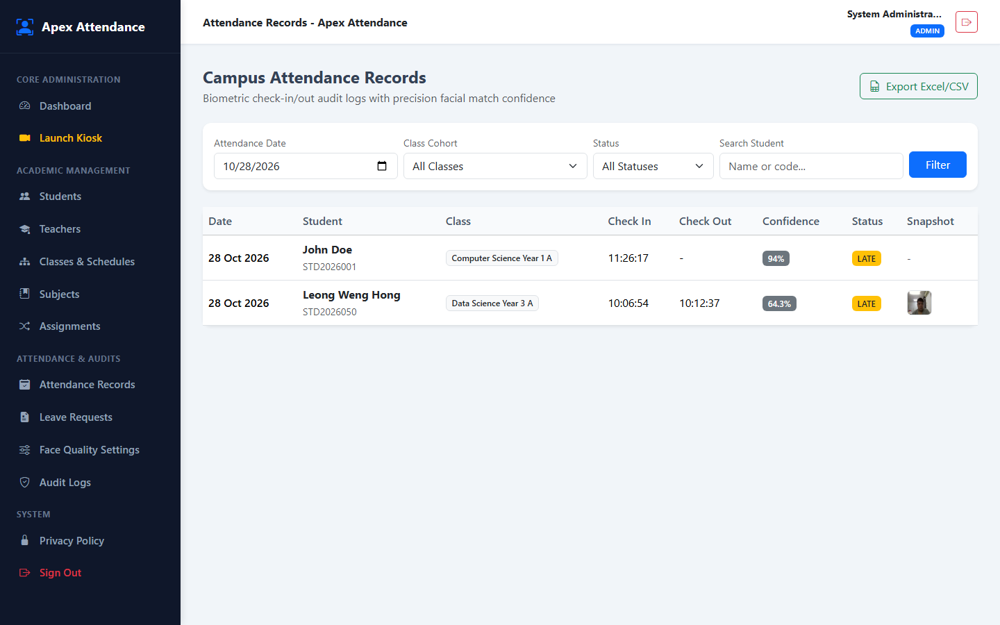
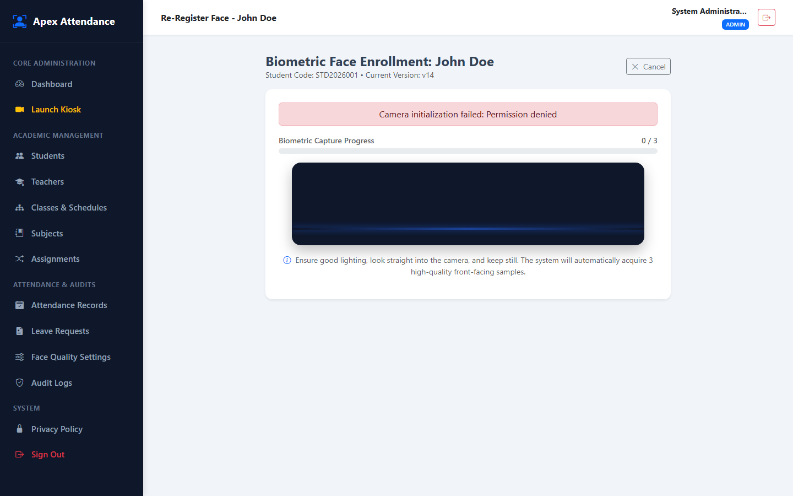

# Face-Attendance-System

> **Apex Facial Recognition Attendance System**  
> Enterprise-ready student attendance management platform with browser-based AI facial recognition, interactive kiosk station, and multi-portal academic administration.

---

## 快速开始（XAMPP）

1. 把项目放置在 `C:\xampp\htdocs\face_attendance_system`

2. 复制 `.env.example` 为 `.env`，确认数据库配置（默认端口 `3307` 或 `3306`）

3. 启动 XAMPP 的 **Apache** 与 **MySQL**

4. 打开 phpMyAdmin 或 MySQL 终端，导入 `database/install.sql` 初始化数据库 `face_attendance_db`

5. 浏览器访问：`http://localhost/face_attendance_system/public/`

6. 使用管理员账号登录：`admin` / `password123`（或点击登录页下方 Quick Demo Fill 快捷填入）

7. 在 **Student Management** 页面点击 **Register**，通过摄像头采集学生 3 组正面生物特征

8. 点击顶部或侧边栏 **Launch Kiosk** 打开全屏智能打卡机，靠近摄像头即可完成秒级毫秒人脸考勤！

---

## Features

- **Multi-Role Academic Portals:** Dedicated dashboards for Administrators, Teachers, and Students.
- **Client-Side Edge AI Biometrics:** Real-time 68-point facial landmarks and 128-dimensional vector embedding powered by `face-api.js` without streaming unencrypted raw video.
- **Autonomous Attendance Kiosk:** Full-screen reception kiosk with animated target HUD, visual feedback, live audio chimes, and automatic real-time recognition.
- **Active Anti-Spoofing & Quality Checks:** Automated validation of head pose (yaw/roll), ambient lighting brightness, Laplacian image sharpness, and multi-frame stability.
- **Smart Duplicate Scan Suppression:** Configurable cool-down window (default 300s) preventing accidental or deliberate repeated punch-ins.
- **Punctuality & Timetable Policy:** Class schedule comparison with configurable grace periods, categorizing scans into On-time, Late, Departure, or Break Check-in.
- **Leave Management with Biometric Shield:** Student leave applications with proof attachments (PDF/JPG/PNG). Approved leaves automatically safeguard students and block improper scans.
- **Tamper-Proof Forensic Audit Logs:** Comprehensive tracking of all authentication events, device signatures, IP addresses, match confidence scores, and descriptor versions.
- **Responsive Multi-Device Layout:** Flawlessly adapted for desktop workstations, tablets/iPads, and smartphones with collapsible offcanvas navigation.
- **One-Click Reporting:** Instant CSV & Excel export for class rosters and institutional attendance logs.
- **100% Offline Capable:** Pre-bundled local neural network weights with zero runtime external CDN dependency.

---

## Screenshots

| Login Page | Administrator Dashboard |
| :---: | :---: |
|  |  |

| Student Management | Autonomous Attendance Kiosk |
| :---: | :---: |
|  |  |

| Attendance Records & Audits | Biometric Face Enrollment |
| :---: | :---: |
|  |  |

---

## Folder structure

```
face_attendance_system/
├── app/
│   ├── Controllers/        # Admin, Teacher, Student, Auth, Kiosk, and API Controllers
│   ├── Core/               # Router, Request, Response, Session, View, Database, Env
│   ├── Helpers/            # CSRF, Flash, Uploaders, Validator, helpers.php
│   ├── Middleware/         # Auth, Role, Guest, and CSRF protection
│   ├── Models/             # Student, Teacher, Attendance, Leave, FaceDescriptor, AuditLog
│   ├── Services/           # AttendanceService, FaceService, ExportService
│   └── routes.php          # Central routing registry
├── config/                 # Application and system configuration
├── database/
│   └── install.sql         # Complete MySQL schema, tables, foreign keys, and seed data
├── docs/
│   └── screenshots/        # High-definition application screenshots
├── public/
│   ├── assets/
│   │   ├── css/style.css   # Custom responsive design system & HUD animations
│   │   ├── js/face/        # Camera stream, quality analysis, pose detection, kiosk flow
│   │   ├── models/         # Pre-trained offline neural network weights (face-api.js)
│   │   └── vendor/         # Offline Bootstrap 5, Bootstrap Icons, face-api packages
│   ├── uploads/            # Encrypted biometric descriptors and student leave proofs
│   └── index.php           # Front Controller entry point
├── tests/
│   └── run_tests.php       # 16-point automated integration test suite
├── .env.example            # Environment template
├── .gitignore              # Privacy and sensitive secret protection
├── LICENSE                 # MIT License
└── README.md
```

---

## 1. XAMPP setup

1. Copy or clone this folder into `C:\xampp\htdocs\face_attendance_system`
2. Start **Apache** and **MySQL** in your XAMPP Control Panel
3. Open phpMyAdmin at `http://localhost/phpmyadmin/` or open MySQL CLI
4. Create database `face_attendance_db` and import `database/install.sql`:
   ```bash
   mysql -u root -p < database/install.sql
   ```
5. Copy `.env.example` to `.env` in the root directory:
   ```ini
   APP_NAME="Apex Facial Attendance System"
   APP_ENV=development
   APP_DEBUG=true
   APP_URL=http://localhost/face_attendance_system/public
   APP_TIMEZONE=Asia/Kuala_Lumpur

   DB_CONNECTION=mysql
   DB_HOST=127.0.0.1
   DB_PORT=3307       # Change to 3306 if using standard XAMPP port
   DB_DATABASE=face_attendance_db
   DB_USERNAME=root
   DB_PASSWORD=
   ```
6. Open in browser: `http://localhost/face_attendance_system/public/`

---

## 2. Preloaded Demo Accounts

All preloaded demo users share the default password: **`password123`**

| Role | Username | Email | Full Name / Class | Key Permissions |
| :--- | :--- | :--- | :--- | :--- |
| **Administrator** | `admin` | `admin@apex.edu` | System Administrator | Full access to settings, user management, kiosk, audit logs |
| **Teacher** | `teacher1` | `alice@apex.edu` | Dr. Alice Johnson (CS Year 1 A) | Class attendance roster, student dossier, scan inspection |
| **Teacher** | `teacher2` | `bob@apex.edu` | Prof. Bob Smith (DS Year 3 A) | Class attendance roster, student dossier, scan inspection |
| **Student** | `student1` | `john@apex.edu` | John Doe (`STD2026001`) | Personal check-in logs, submit leave applications, view face status |
| **Student** | `student2` | `jane@apex.edu` | Jane Smith (`STD2026002`) | Personal check-in logs, submit leave applications, view face status |
| **Student** | `student3` | `alex@apex.edu` | Alex Wong (`STD2026003`) | Personal check-in logs, submit leave applications, view face status |

*Tip: The login screen provides instant one-click demo buttons (`Admin`, `Teacher`, `Student`) for rapid switching.*

---

## 3. Biometric Face Recognition Engine

The biometric engine operates strictly inside the client's browser using HTML5 Canvas and WebGL:

1. **Detection & Alignment:** Uses `tiny_face_detector` to locate faces in 60fps video streams.
2. **Landmark Extraction:** Computes 68 precise 2D facial fiducial coordinates.
3. **Descriptor Vectorization:** Generates a 128-element normalized floating-point array representing biometric facial geometry.
4. **Matching:** Computes Euclidean distance against active enrolled student models:
   - Euclidean distance $\le 0.55$: Match Confirmed (High Precision).
   - Match confidence percentage is derived as `max(0, (1 - distance) * 100)`.

Neural weights are stored locally in `public/assets/models/`:
- `tiny_face_detector_model-weights_manifest.json` & shards
- `face_landmark_68_model-weights_manifest.json` & shards
- `face_recognition_model-weights_manifest.json` & shards

---

## 4. Attendance Kiosk & Punctuality Policy

The Autonomous Kiosk (`/kiosk`) provides touchless attendance:

- **Scan Cooldown:** After a student punches in, their ID enters a 300-second cooldown window to prevent double logging.
- **Check-In vs Late:** Scans within class start time plus grace period are marked `checked_in`. Scans arriving after the grace period are automatically flagged `late`.
- **Check-Out:** A subsequent scan after class end or during dismissal time records the `check_out` timestamp and updates daily duration.
- **Approved Leave Block:** If a student has an approved medical or emergency leave for today, the kiosk displays a protective notice and prevents erroneous attendance marking.

---

## 5. Camera & WebRTC Permissions

- **Localhost:** Modern browsers (Chrome, Edge, Firefox) grant camera permissions automatically on `http://localhost/` and `http://127.0.0.1/`.
- **LAN / Network Hosting:** If accessing across Wi-Fi or local IP addresses (e.g. `http://192.168.1.100/`), browsers mandate **HTTPS** for `navigator.mediaDevices.getUserMedia()`.
- **Testing on LAN without SSL:** You can whitelist your host in Chrome by opening:
  `chrome://flags/#unsafely-treat-insecure-origin-as-secure`
  and adding your testing IP (e.g. `http://192.168.1.100:8080`).

---

## 6. Automated Testing Suite

Run the built-in 16-point integration test suite via CLI:

```bash
php tests/run_tests.php
```

Expected output:

```text
========================================================
   APEX FACIAL ATTENDANCE SYSTEM - AUTOMATED TEST SUITE 
========================================================

  [PASS] Database PDO connection established
  [PASS] Admin demo user exists
  [PASS] Password verification for admin (password123)
  [PASS] Invalid password rejected
  [PASS] Student #1 (John Doe) retrieved with class details
  [PASS] Teacher #1 (Dr. Alice Johnson) retrieved
  [PASS] Face Registration Service saves 3 multi-sample descriptors
  [PASS] Student face status updated to registered (is_face_registered=1, version >= 1)
  [PASS] Active face descriptors stored correctly (3 samples)
  [PASS] Batch active descriptors retrieved for Kiosk matcher
  [PASS] First scan commits Check-In successfully
  [PASS] Immediate re-scan is blocked by duplicate scan protection
  [PASS] Student leave application inserted with pending status
  [PASS] Leave application approved by admin
  [PASS] Scan rejected when student has approved leave today
  [PASS] Audit logs automatically created and populated

========================================================
   TEST SUMMARY: 16 PASSED, 0 FAILED
========================================================
```

---

## System flow

1. **Enrollment:** Administrator or Student captures 3 clear frontal face samples via webcam.
2. **Descriptor Vault:** The 128-dimensional vectors are stored in `face_descriptors` linked to the student profile.
3. **Kiosk Initialization:** The kiosk pre-caches all active student descriptors on boot.
4. **Live Stream Scan:** The camera detects a student and computes their 128-d vector in real time.
5. **Local Vector Comparison:** Euclidean distance is evaluated client-side against the cached roster.
6. **Backend Verification:** Server verifies duplicate window, class schedule, and approved leaves.
7. **Attendance Committal:** Record is stored in `attendances` table with audit trail, timestamp, and visual snapshot.

---

## Security & Privacy notes

- **Zero Raw Video Transmission:** Video streams are processed locally in browser RAM; only 128-d mathematical vectors are transmitted.
- **Session Security:** Session ID regeneration upon login prevents session fixation attacks.
- **Upload Directory Hardening:** `public/uploads/` is protected with `.htaccess` directives preventing PHP execution.
- **Privacy `.gitignore`:** Biometric face thumbnails, uploaded medical certificates, and `.env` credentials are strictly ignored from version control.
- **SQL Injection Defense:** 100% prepared PDO statements throughout all models and services.
- **CSRF Protection:** Synchronizer token pattern with `csrf_field()` validation across all POST requests.

---

## License

This project is licensed under the [MIT License](LICENSE).